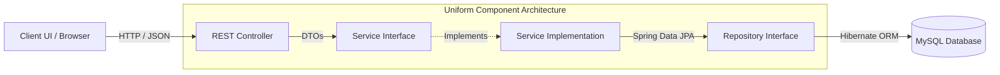

# Crumb Bakery Platform — UML Class Diagram & OOP Architecture Specification
**University Project — SE1020 Object Oriented Programming**  
**Group:** WD36 (6 Members)  
**System:** Crumb Bakery Order & Custom Cake Booking Platform  
**Backend:** Spring Boot 3, Spring Data JPA, Hibernate, MySQL  

---

## 1. Domain Model UML Class Diagram

```mermaid
classDiagram
    %% ==========================================
    %% 1. CUSTOMER COMPONENT HIERARCHY
    %% ==========================================
    class Customer {
        <<abstract>>
        -Long id
        -String fullName
        -String email
        -String phone
        -String password
        -String address
        -String role
        -Integer loyaltyPoints
        -boolean active
        -LocalDateTime createdAt
        -String customerType
        +calculateDiscount(double subtotal)* double
        +getCustomerBadge()* String
        +getMaxActiveBookings()* int
        +getDeliveryFeeDiscount()* double
    }

    class RegularCustomer {
        -String preferredBranch
        +calculateDiscount(double subtotal) double
        +getCustomerBadge() String
        +getMaxActiveBookings() int
        +getDeliveryFeeDiscount() double
    }

    class PremiumCustomer {
        -LocalDate membershipExpiry
        -String vipConciergeNote
        +calculateDiscount(double subtotal) double
        +getCustomerBadge() String
        +getMaxActiveBookings() int
        +getDeliveryFeeDiscount() double
    }

    Customer <|-- RegularCustomer : Inheritance (customer_type = 'REGULAR')
    Customer <|-- PremiumCustomer : Inheritance (customer_type = 'PREMIUM')

    %% ==========================================
    %% 2. PRODUCT COMPONENT HIERARCHY
    %% ==========================================
    class BakeryProduct {
        <<abstract>>
        -Long id
        -String name
        -String description
        -double basePrice
        -String imageUrl
        -int stockQuantity
        -boolean available
        -double rating
        -int reviewCount
        -String allergens
        -LocalDateTime createdAt
        -String productType
        +calculateFinalPrice(int quantity)* double
        +getProductCategory()* String
        +getStorageInstructions()* String
        +getServingRecommendation()* String
    }

    class Cake {
        -int layers
        -String frostingType
        +calculateFinalPrice(int quantity) double
        +getProductCategory() String
        +getStorageInstructions() String
        +getServingRecommendation() String
    }

    class Pastry {
        -String pastryType
        -boolean warmable
        +calculateFinalPrice(int quantity) double
        +getProductCategory() String
        +getStorageInstructions() String
        +getServingRecommendation() String
    }

    class Bread {
        -int loafWeightGrams
        -boolean sourdough
        +calculateFinalPrice(int quantity) double
        +getProductCategory() String
        +getStorageInstructions() String
        +getServingRecommendation() String
    }

    BakeryProduct <|-- Cake : Inheritance (product_type = 'CAKE')
    BakeryProduct <|-- Pastry : Inheritance (product_type = 'PASTRY')
    BakeryProduct <|-- Bread : Inheritance (product_type = 'BREAD')

    %% ==========================================
    %% 3. CUSTOM CAKE COMPONENT HIERARCHY
    %% ==========================================
    class CustomCake {
        <<abstract>>
        -Long id
        -Customer customer
        -String flavor
        -String sizeTiers
        -String filling
        -String frosting
        -String inscription
        -String colorTheme
        -String dietaryNotes
        -String specialInstructions
        -String referenceImageUrl
        -LocalDate eventDate
        -String status
        -double estimatedPrice
        -LocalDateTime createdAt
        -String cakeType
        +calculateEstimatedPrice()* double
        +getEventSummary()* String
        +getPreparationLeadDays()* int
        +getSpecialtyAddons()* String
    }

    class BirthdayCake {
        -Integer ageNumber
        -boolean candleSetIncluded
        -String characterTheme
        +calculateEstimatedPrice() double
        +getEventSummary() String
        +getPreparationLeadDays() int
        +getSpecialtyAddons() String
    }

    class WeddingCake {
        -int tierCount
        -boolean freshFlorals
        -boolean tastingKitOrdered
        +calculateEstimatedPrice() double
        +getEventSummary() String
        +getPreparationLeadDays() int
        +getSpecialtyAddons() String
    }

    class CelebrationCake {
        -String occasionType
        -boolean edibleGoldLeaf
        -String customTopperText
        +calculateEstimatedPrice() double
        +getEventSummary() String
        +getPreparationLeadDays() int
        +getSpecialtyAddons() String
    }

    CustomCake <|-- BirthdayCake : Inheritance (cake_type = 'BIRTHDAY')
    CustomCake <|-- WeddingCake : Inheritance (cake_type = 'WEDDING')
    CustomCake <|-- CelebrationCake : Inheritance (cake_type = 'CELEBRATION')

    %% ==========================================
    %% 4. ORDER COMPONENT HIERARCHY & ORDER ITEM
    %% ==========================================
    class Order {
        <<abstract>>
        -Long id
        -String orderNumber
        -Customer customer
        -List~OrderItem~ items
        -double subtotal
        -double discountAmount
        -double deliveryFee
        -double totalAmount
        -String status
        -String orderNotes
        -LocalDateTime createdAt
        -String orderType
        +addItem(OrderItem item) void
        +calculateDeliveryFee()* double
        +getDeliverySummary()* String
        +getFulfillmentTimeEstimate()* String
    }

    class DeliveryOrder {
        -String deliveryAddress
        -String contactPhone
        -String specialDeliveryInstructions
        -double distanceKm
        +calculateDeliveryFee() double
        +getDeliverySummary() String
        +getFulfillmentTimeEstimate() String
    }

    class PickupOrder {
        -String pickupTimeSlot
        -String pickupCounter
        -boolean curbsideRequested
        +calculateDeliveryFee() double
        +getDeliverySummary() String
        +getFulfillmentTimeEstimate() String
    }

    class OrderItem {
        -Long id
        -Order order
        -BakeryProduct product
        -String productName
        -int quantity
        -double unitPrice
        -double itemSubtotal
    }

    Order <|-- DeliveryOrder : Inheritance (order_type = 'DELIVERY')
    Order <|-- PickupOrder : Inheritance (order_type = 'PICKUP')

    %% ==========================================
    %% 5. BOOKING COMPONENT HIERARCHY
    %% ==========================================
    class Booking {
        <<abstract>>
        -Long id
        -String bookingReference
        -Customer customer
        -Order order
        -CustomCake customCake
        -LocalDate bookingDate
        -String timeSlot
        -String status
        -String specialInstructions
        -LocalDateTime createdAt
        -String bookingType
        +calculateServiceFee()* double
        +getFulfillmentInstructions()* String
        +isChilledTransportRequired()* boolean
    }

    class PickupBooking {
        -String pickupBranchLocation
        -boolean curbsideAssistance
        +calculateServiceFee() double
        +getFulfillmentInstructions() String
        +isChilledTransportRequired() boolean
    }

    class DeliveryBooking {
        -String deliveryAddress
        -String contactPhone
        -boolean refrigeratedVanRequired
        +calculateServiceFee() double
        +getFulfillmentInstructions() String
        +isChilledTransportRequired() boolean
    }

    Booking <|-- PickupBooking : Inheritance (booking_type = 'PICKUP')
    Booking <|-- DeliveryBooking : Inheritance (booking_type = 'DELIVERY')

    %% ==========================================
    %% 6. PAYMENT COMPONENT HIERARCHY & REVIEW
    %% ==========================================
    class Payment {
        <<abstract>>
        -Long id
        -String paymentReference
        -Customer customer
        -Order order
        -CustomCake customCake
        -double amount
        -String status
        -LocalDateTime paymentDate
        -String paymentType
        +processPayment()* boolean
        +generateReceipt()* String
        +getTransactionFee()* double
    }

    class CashPayment {
        -double cashTendered
        -double changeDue
        -boolean collectedOnHandoff
        +processPayment() boolean
        +generateReceipt() String
        +getTransactionFee() double
    }

    class CardPayment {
        -String cardHolderName
        -String cardLastFour
        -String transactionAuthCode
        -String billingAddress
        +processPayment() boolean
        +generateReceipt() String
        +getTransactionFee() double
    }

    class Review {
        -Long id
        -Customer customer
        -BakeryProduct product
        -Order order
        -String customerName
        -String productName
        -int rating
        -String comment
        -boolean approved
        -LocalDateTime createdAt
    }

    Payment <|-- CashPayment : Inheritance (payment_type = 'CASH')
    Payment <|-- CardPayment : Inheritance (payment_type = 'CARD')

    %% ==========================================
    %% ASSOCIATIONS & MULTIPLICITIES
    %% ==========================================
    Customer "1" --> "*" Order : places
    Customer "1" --> "*" CustomCake : requests
    Customer "1" --> "*" Booking : reserves
    Customer "1" --> "*" Payment : funds
    Customer "1" --> "*" Review : writes

    Order "1" *-- "1..*" OrderItem : composition
    OrderItem "*" --> "1" BakeryProduct : references

    Booking "*" --> "0..1" Order : schedules
    Booking "*" --> "0..1" CustomCake : schedules

    Payment "*" --> "0..1" Order : settles
    Payment "*" --> "0..1" CustomCake : settles

    Review "*" --> "0..1" BakeryProduct : rates
    Review "*" --> "0..1" Order : feedback for
```

---

## 2. Four Pillars of OOP in the Architecture

| OOP Pillar | Architectural Realization in Crumb | Code Location & Proof |
| :--- | :--- | :--- |
| **Encapsulation** | All fields across all entities are `private`. State mutation is regulated via Lombok `@Getter` / `@Setter` accessors, entity constructor initializers, and business methods (e.g. `addItem()`). | `com.crumb.*.entity.*` |
| **Inheritance** | Single-Table JPA Inheritance (`@Inheritance(strategy = InheritanceType.SINGLE_TABLE)`) with discriminator columns (`@DiscriminatorColumn`, `@DiscriminatorValue`) across all 6 modules: `Customer`, `BakeryProduct`, `CustomCake`, `Order`, `Booking`, and `Payment`. | Table discriminator columns: `customer_type`, `product_type`, `cake_type`, `order_type`, `booking_type`, `payment_type` |
| **Polymorphism** | Abstract methods in base classes overridden with specialized business algorithms in subclasses (e.g. `calculateDiscount()`, `calculateFinalPrice()`, `calculateEstimatedPrice()`, `calculateDeliveryFee()`, `processPayment()`). | Subclasses execute distinct dynamic dispatch logic without type-checking `instanceof`. |
| **Abstraction** | Abstract superclasses (`Customer`, `BakeryProduct`, `CustomCake`, `Order`, `Booking`, `Payment`) define contracts. Service interfaces (`CustomerService`, `ProductService`, etc.) separate client API specifications from concrete implementations (`CustomerServiceImpl`). | Layered architecture in `com.crumb.*.service` and `com.crumb.*.entity` |

---

## 3. Layered Tier Architecture per Component

For each of the 6 components, the system adheres strictly to the decoupled 4-layer design pattern:

### Component Responsibility Matrix
- **`customer`**: `CustomerController` $\rightarrow$ `CustomerService` / `CustomerServiceImpl` $\rightarrow$ `CustomerRepository` $\rightarrow$ `Customer` (`RegularCustomer`, `PremiumCustomer`).
- **`product`**: `ProductController` $\rightarrow$ `ProductService` / `ProductServiceImpl` $\rightarrow$ `ProductRepository` $\rightarrow$ `BakeryProduct` (`Cake`, `Pastry`, `Bread`).
- **`customcake`**: `CustomCakeController` $\rightarrow$ `CustomCakeService` / `CustomCakeServiceImpl` $\rightarrow$ `CustomCakeRepository` $\rightarrow$ `CustomCake` (`BirthdayCake`, `WeddingCake`, `CelebrationCake`).
- **`order`**: `OrderController` $\rightarrow$ `OrderService` / `OrderServiceImpl` $\rightarrow$ `OrderRepository` $\rightarrow$ `Order` (`DeliveryOrder`, `PickupOrder`), `OrderItem`.
- **`booking`**: `BookingController` $\rightarrow$ `BookingService` / `BookingServiceImpl` $\rightarrow$ `BookingRepository` $\rightarrow$ `Booking` (`PickupBooking`, `DeliveryBooking`).
- **`payment`**: `PaymentController` / `ReviewController` $\rightarrow$ `PaymentService` / `PaymentServiceImpl` $\rightarrow$ `PaymentRepository` / `ReviewRepository` $\rightarrow$ `Payment` (`CashPayment`, `CardPayment`), `Review`.
