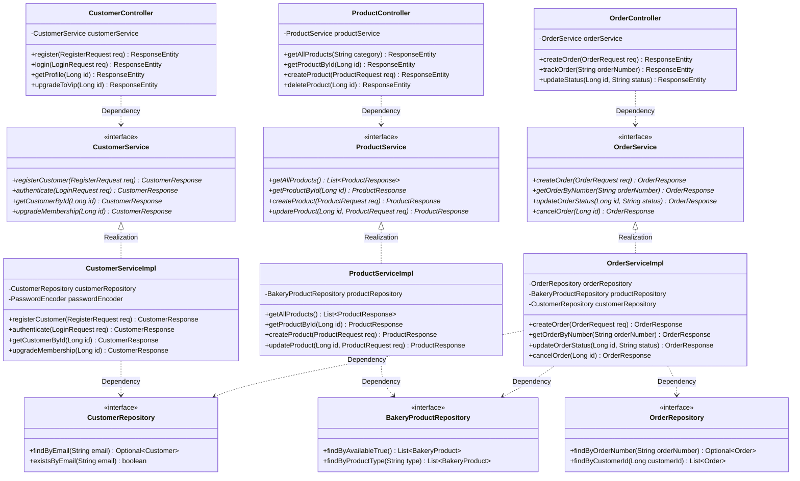

# Crumb Bakery Platform — UML Class Diagram Specification
**University Project — SE1020 Object Oriented Programming**  
**Group:** WD36 (6 Students)  
**System:** Crumb Bakery Order & Custom Cake Booking Platform  
**Backend:** Spring Boot 3, Spring Data JPA, Hibernate, MySQL  

---

## 1. UML Relationship Notations Key

This architecture adheres strictly to standard UML 2.0 object-oriented relationship notations:

| UML Symbol | Relationship Name | Mermaid Syntax | Notation Meaning & Semantics | Concrete Implementation in Crumb |
| :---: | :--- | :---: | :--- | :--- |
| **──>** | **Association** | `ClassA --> ClassB` | **Directed Navigational Association:** A solid line with an open arrowhead indicating directional reference and navigation between classes. | `Customer --> Order`, `OrderItem --> BakeryProduct`, `Customer --> Review` |
| **──▷** | **Inheritance** (Generalization) | `SuperClass <\|-- SubClass` | **Generalization / Subclassing:** A solid line with a hollow closed triangle at the parent end, indicating an "is-a" taxonomy and attribute/method inheritance. | `Customer <\|-- RegularCustomer`, `BakeryProduct <\|-- Cake`, `CustomCake <\|-- BirthdayCake` |
| **┄┄▷** | **Realization / Implementation** | `Interface <\|.. Class` | **Interface Implementation:** A dashed line with a hollow closed triangle at the interface end, indicating that a concrete class implements the contract declared by an interface. | `CustomerService <\|.. CustomerServiceImpl`, `OrderService <\|.. OrderServiceImpl` |
| **┄┄>** | **Dependency** | `Client ..> Supplier` | **Usage / Supplier Dependency:** A dashed line with an open arrowhead showing a transient dependency where one class relies on another during runtime execution. | `CustomerController ..> CustomerService`, `OrderServiceImpl ..> OrderRepository` |
| **◇──** | **Aggregation** | `Whole o-- Part` | **Shared / Weak Aggregation:** A solid line with a hollow diamond at the whole end. "Part" can exist independently of "Whole" and can outlive it. | `Booking o-- Order` (An order exists independently of a calendar delivery booking slot). |
| **◆──** | **Composition** | `Whole *-- Part` | **Exclusive / Strong Composition:** A solid line with a filled black diamond at the whole end. "Part" lifecycle is bound to "Whole" and deleted if "Whole" is destroyed. | `Order *-- OrderItem` (CascadeType.ALL + orphanRemoval = true; line items cannot exist without an order). |

---

## 2. Domain Model UML Class Diagram

```mermaid
classDiagram
    %% ==========================================
    %% 1. CUSTOMER COMPONENT HIERARCHY
    %% ==========================================
    class Customer {
        <<abstract>>
        -Long id
        -String fullName
        -String email
        -String phone
        -String password
        -String address
        -String role
        -Integer loyaltyPoints
        -boolean active
        -LocalDateTime createdAt
        -String customerType
        +calculateDiscount(double subtotal)* double
        +getCustomerBadge()* String
        +getMaxActiveBookings()* int
        +getDeliveryFeeDiscount()* double
    }

    class RegularCustomer {
        -String preferredBranch
        +calculateDiscount(double subtotal) double
        +getCustomerBadge() String
        +getMaxActiveBookings() int
        +getDeliveryFeeDiscount() double
    }

    class PremiumCustomer {
        -LocalDate membershipExpiry
        -String vipConciergeNote
        +calculateDiscount(double subtotal) double
        +getCustomerBadge() String
        +getMaxActiveBookings() int
        +getDeliveryFeeDiscount() double
    }

    Customer <|-- RegularCustomer : Inheritance
    Customer <|-- PremiumCustomer : Inheritance

    %% ==========================================
    %% 2. PRODUCT COMPONENT HIERARCHY
    %% ==========================================
    class BakeryProduct {
        <<abstract>>
        -Long id
        -String name
        -String description
        -double basePrice
        -String imageUrl
        -int stockQuantity
        -boolean available
        -double rating
        -int reviewCount
        -String allergens
        -LocalDateTime createdAt
        -String productType
        +calculateFinalPrice(int quantity)* double
        +getProductCategory()* String
        +getStorageInstructions()* String
        +getServingRecommendation()* String
    }

    class Cake {
        -int layers
        -String frostingType
        +calculateFinalPrice(int quantity) double
        +getProductCategory() String
        +getStorageInstructions() String
        +getServingRecommendation() String
    }

    class Pastry {
        -String pastryType
        -boolean warmable
        +calculateFinalPrice(int quantity) double
        +getProductCategory() String
        +getStorageInstructions() String
        +getServingRecommendation() String
    }

    class Bread {
        -int loafWeightGrams
        -boolean sourdough
        +calculateFinalPrice(int quantity) double
        +getProductCategory() String
        +getStorageInstructions() String
        +getServingRecommendation() String
    }

    BakeryProduct <|-- Cake : Inheritance
    BakeryProduct <|-- Pastry : Inheritance
    BakeryProduct <|-- Bread : Inheritance

    %% ==========================================
    %% 3. CUSTOM CAKE COMPONENT HIERARCHY
    %% ==========================================
    class CustomCake {
        <<abstract>>
        -Long id
        -Customer customer
        -String flavor
        -String sizeTiers
        -String filling
        -String frosting
        -String inscription
        -String colorTheme
        -String dietaryNotes
        -String specialInstructions
        -String referenceImageUrl
        -LocalDate eventDate
        -String status
        -double estimatedPrice
        -LocalDateTime createdAt
        -String cakeType
        +calculateEstimatedPrice()* double
        +getEventSummary()* String
        +getPreparationLeadDays()* int
        +getSpecialtyAddons()* String
    }

    class BirthdayCake {
        -Integer ageNumber
        -boolean candleSetIncluded
        -String characterTheme
        +calculateEstimatedPrice() double
        +getEventSummary() String
        +getPreparationLeadDays() int
        +getSpecialtyAddons() String
    }

    class WeddingCake {
        -int tierCount
        -boolean freshFlorals
        -boolean tastingKitOrdered
        +calculateEstimatedPrice() double
        +getEventSummary() String
        +getPreparationLeadDays() int
        +getSpecialtyAddons() String
    }

    class CelebrationCake {
        -String occasionType
        -boolean edibleGoldLeaf
        -String customTopperText
        +calculateEstimatedPrice() double
        +getEventSummary() String
        +getPreparationLeadDays() int
        +getSpecialtyAddons() String
    }

    CustomCake <|-- BirthdayCake : Inheritance
    CustomCake <|-- WeddingCake : Inheritance
    CustomCake <|-- CelebrationCake : Inheritance

    %% ==========================================
    %% 4. ORDER COMPONENT HIERARCHY & ORDER ITEM
    %% ==========================================
    class Order {
        <<abstract>>
        -Long id
        -String orderNumber
        -Customer customer
        -List~OrderItem~ items
        -double subtotal
        -double discountAmount
        -double deliveryFee
        -double totalAmount
        -String status
        -String orderNotes
        -LocalDateTime createdAt
        -String orderType
        +addItem(OrderItem item) void
        +calculateDeliveryFee()* double
        +getDeliverySummary()* String
        +getFulfillmentTimeEstimate()* String
    }

    class DeliveryOrder {
        -String deliveryAddress
        -String contactPhone
        -String specialDeliveryInstructions
        -double distanceKm
        +calculateDeliveryFee() double
        +getDeliverySummary() String
        +getFulfillmentTimeEstimate() String
    }

    class PickupOrder {
        -String pickupTimeSlot
        -String pickupCounter
        -boolean curbsideRequested
        +calculateDeliveryFee() double
        +getDeliverySummary() String
        +getFulfillmentTimeEstimate() String
    }

    class OrderItem {
        -Long id
        -Order order
        -BakeryProduct product
        -String productName
        -int quantity
        -double unitPrice
        -double itemSubtotal
    }

    Order <|-- DeliveryOrder : Inheritance
    Order <|-- PickupOrder : Inheritance

    %% ==========================================
    %% 5. BOOKING COMPONENT HIERARCHY
    %% ==========================================
    class Booking {
        <<abstract>>
        -Long id
        -String bookingReference
        -Customer customer
        -Order order
        -CustomCake customCake
        -LocalDate bookingDate
        -String timeSlot
        -String status
        -String specialInstructions
        -LocalDateTime createdAt
        -String bookingType
        +calculateServiceFee()* double
        +getFulfillmentInstructions()* String
        +isChilledTransportRequired()* boolean
    }

    class PickupBooking {
        -String pickupBranchLocation
        -boolean curbsideAssistance
        +calculateServiceFee() double
        +getFulfillmentInstructions() String
        +isChilledTransportRequired() boolean
    }

    class DeliveryBooking {
        -String deliveryAddress
        -String contactPhone
        -boolean refrigeratedVanRequired
        +calculateServiceFee() double
        +getFulfillmentInstructions() String
        +isChilledTransportRequired() boolean
    }

    Booking <|-- PickupBooking : Inheritance
    Booking <|-- DeliveryBooking : Inheritance

    %% ==========================================
    %% 6. PAYMENT COMPONENT HIERARCHY & REVIEW
    %% ==========================================
    class Payment {
        <<abstract>>
        -Long id
        -String paymentReference
        -Customer customer
        -Order order
        -CustomCake customCake
        -double amount
        -String status
        -LocalDateTime paymentDate
        -String paymentType
        +processPayment()* boolean
        +generateReceipt()* String
        +getTransactionFee()* double
    }

    class CashPayment {
        -double cashTendered
        -double changeDue
        -boolean collectedOnHandoff
        +processPayment() boolean
        +generateReceipt() String
        +getTransactionFee() double
    }

    class CardPayment {
        -String cardHolderName
        -String cardLastFour
        -String transactionAuthCode
        -String billingAddress
        +processPayment() boolean
        +generateReceipt() String
        +getTransactionFee() double
    }

    class Review {
        -Long id
        -Customer customer
        -BakeryProduct product
        -Order order
        -String customerName
        -String productName
        -int rating
        -String comment
        -boolean approved
        -LocalDateTime createdAt
    }

    Payment <|-- CashPayment : Inheritance
    Payment <|-- CardPayment : Inheritance

    %% ==========================================
    %% COMPOSITION, AGGREGATION & ASSOCIATION
    %% ==========================================
    %% Composition (*--): Order strictly owns OrderItem lifecycle
    Order "1" *-- "1..*" OrderItem : Composition

    %% Aggregation (o--): Booking and Payment aggregate Order/CustomCake non-destructively
    Booking "0..*" o-- "0..1" Order : Aggregation
    Booking "0..*" o-- "0..1" CustomCake : Aggregation
    Payment "0..*" o-- "0..1" Order : Aggregation
    Payment "0..*" o-- "0..1" CustomCake : Aggregation

    %% Association (-->): Navigational directed associations
    Customer "1" --> "*" Order : Association (places)
    Customer "1" --> "*" CustomCake : Association (requests)
    Customer "1" --> "*" Booking : Association (reserves)
    Customer "1" --> "*" Payment : Association (funds)
    Customer "1" --> "*" Review : Association (writes)
    OrderItem "*" --> "1" BakeryProduct : Association (references)
    Review "*" --> "0..1" BakeryProduct : Association (rates)
    Review "*" --> "0..1" Order : Association (evaluates)

    %% Dependency (..>): Operational runtime references
    Order ..> Customer : Dependency
    Payment ..> Customer : Dependency
```

---

## 3. Tiered Service Architecture Diagram (Realization & Dependency)

This diagram details the decoupled 4-layer design pattern, highlighting **Realization / Implementation (`<|..`)** and **Dependency (`..>`)**:

---

## 4. OOP Pillars & Viva Explanation Guide

| OOP Concept | UML Symbol Used | Technical Explanation for Viva Examiner |
| :--- | :---: | :--- |
| **Inheritance** | **`SuperClass <\|-- SubClass`** | Subclasses (`RegularCustomer`, `Cake`, `BirthdayCake`, `DeliveryOrder`, etc.) inherit all common database-mapped fields and behaviors from their respective abstract superclasses. Implemented in JPA via `@Inheritance(strategy = InheritanceType.SINGLE_TABLE)` and differentiated using discriminator columns (`@DiscriminatorColumn`). |
| **Realization** | **`Interface <\|.. Implementation`** | Service implementation classes (`CustomerServiceImpl`, `OrderServiceImpl`) realize the method signatures declared by their corresponding Service interfaces (`CustomerService`, `OrderService`). This decouples business logic from client controllers. |
| **Composition** | **`Whole *-- Part`** | `Order *-- OrderItem`: An `OrderItem` is strictly owned by its parent `Order`. In Spring Data JPA, this is enforced through `@OneToMany(cascade = CascadeType.ALL, orphanRemoval = true)`. Deleting an order cascades and deletes its line items automatically. |
| **Aggregation** | **`Whole o-- Part`** | `Booking o-- Order` and `Payment o-- Order`: A booking or payment aggregates an existing order without owning its entire lifecycle. If a booking is rescheduled or cancelled, the underlying bakery order remains intact in the database. |
| **Association** | **`ClassA --> ClassB`** | Navigational connections between domain concepts. A `Customer` places multiple `Order`s and writes multiple `Review`s. An `OrderItem` references a `BakeryProduct`. |
| **Dependency** | **`Client ..> Supplier`** | Controllers depend on Service interfaces via Spring constructor injection (`@Autowired` / constructor injection). Services depend on Spring Data JPA repositories to perform CRUD operations on database tables. |
| **Encapsulation** | `-attribute` / `+method()` | Every class declares attributes as `private` (`-`), preventing direct external tampering. Access is mediated strictly through public getters/setters (`+`) generated by Project Lombok and domain methods. |
| **Polymorphism** | `+method()*` $\rightarrow$ `+method()` | Abstract methods in base classes are overridden with customized algorithms in concrete subclasses. For example, `Customer.calculateDiscount()` executes `0.0` for regular customers, but returns `subtotal * 0.10` for premium customers. Runtime polymorphism dynamically dispatches the correct logic without `instanceof` conditionals. |
